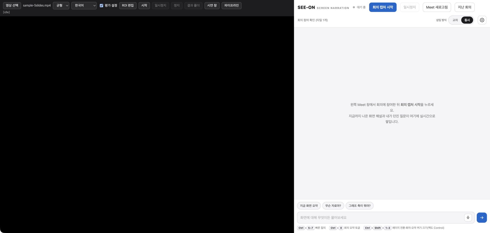
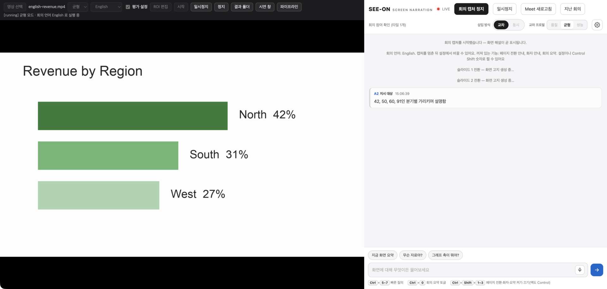
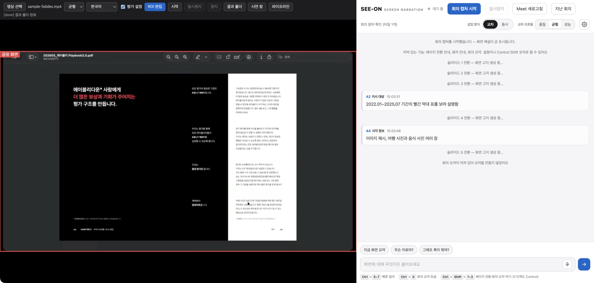
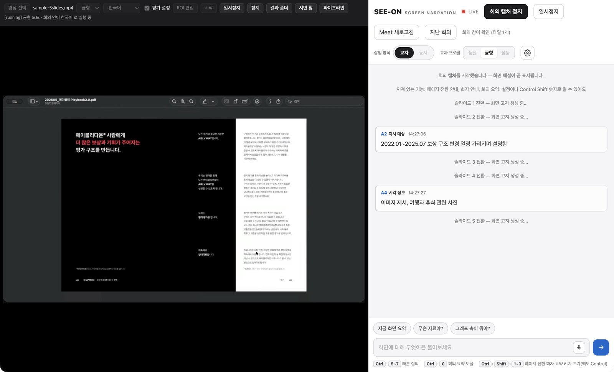
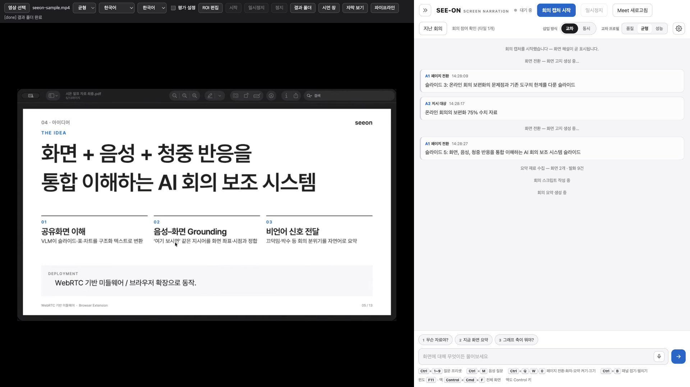
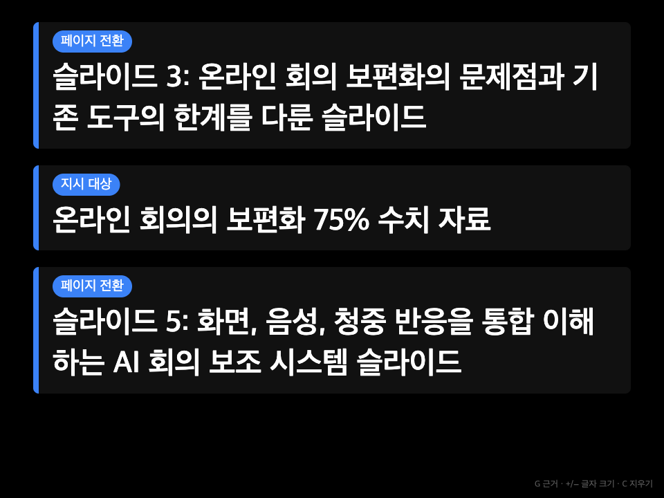
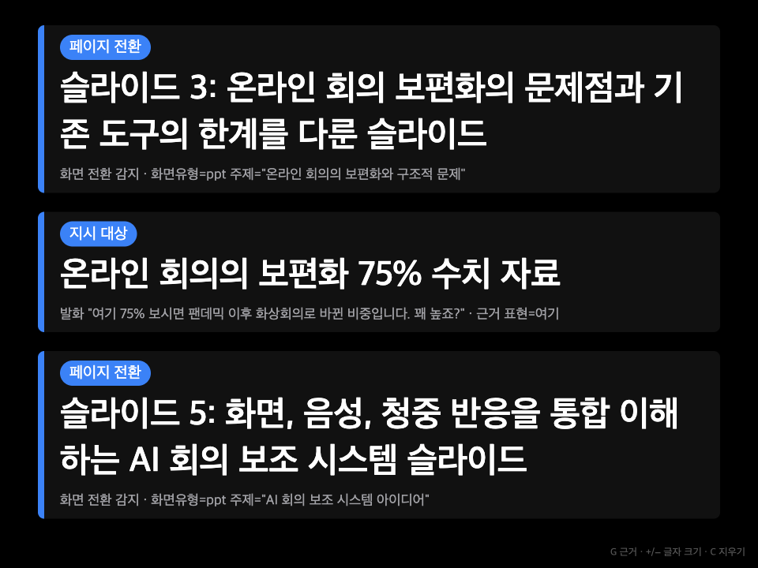
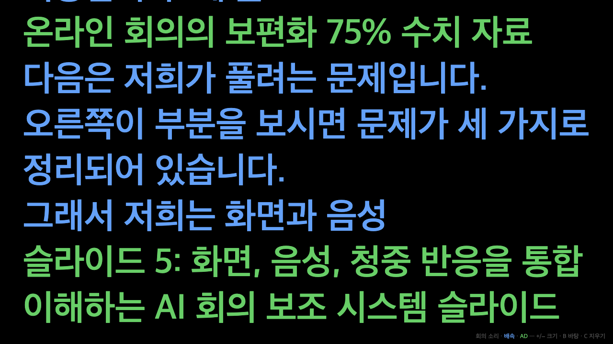
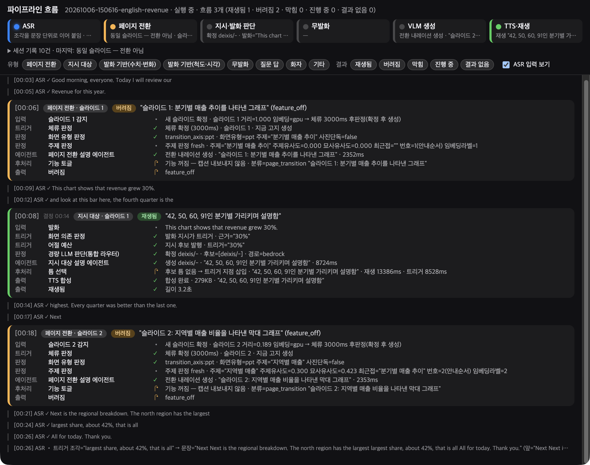
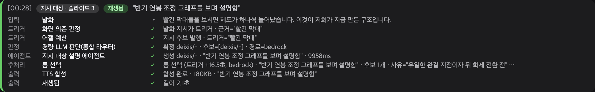

# SEEON 실험실 — 녹화 영상으로 화면 해설 평가하기

**SEEON 실험실**은 실제 회의 대신 **녹화 영상**을 SEEON 제품 화면에 넣어, 지금 제품과 똑같은 화면 해설을 듣고
평가에 쓸 결과물을 한 폴더에 남기는 도구예요.
해설을 만드는 부분은 제품과 같은 코드라서, 실험실에서 잰 수치가 곧 제품의 수치예요.
실험실은 **입력(녹화 영상)과 출력(결과 폴더)만** 덧붙여요.

- 같은 영상을 여러 번, 여러 설정으로 돌려 해설을 비교할 수 있어요.
- 결과 폴더에는 받아쓰기, 해설 목록, 실제로 들린 소리, 슬라이드 이미지가 함께 남아 탐지(3.1)·이해도(3.2) 평가에 바로 써요.
- 시연 창·자막 보기 창으로 해설이 나오는 모습을 크게 보여 줄 수 있어요.

> 실험실은 `experiment` 브랜치에만 있어요. 제품(production)에는 넣지 않아요.
> 제품 사용법은 [제품 README](../README.md) 를 봐 주세요.



---

## 목차

- [준비와 실행](#준비와-실행)
- [창 구성](#창-구성)
- [1. 영상·언어·평가 설정 고르기](#1-영상언어평가-설정-고르기)
- [2. 화면 영역(ROI) 맞추기](#2-화면-영역roi-맞추기)
- [3. 실행·일시정지·정지](#3-실행일시정지정지)
- [4. 결과 확인](#4-결과-확인)
- [시연 창](#시연-창)
- [자막 보기 창](#자막-보기-창)
- [파이프라인 창](#파이프라인-창)
- [여러 영상을 차례로 돌리기 — 자동 실행](#여러-영상을-차례로-돌리기--자동-실행)
- [평가 도구](#평가-도구)
- [자주 막히는 곳](#자주-막히는-곳)

---

## 준비와 실행

- **Windows** — `SEEON Lab` 설치본을 설치해 실행해요. 제품 앱과 아이콘이 달라요(남색 S).
- **소스에서** — `experiment` 브랜치에서 `npm run lab` 으로 띄워요.

처음 준비(코드 받기, 설정 파일, 한국어 분석 모델, 화면 해설 AI 서버 연결)는
[평가 실행 방법](../docs/eval/how-to-run.md) 0장을 따라 해요.

- 실험실 창은 한 번에 하나만 띄워요. 제품 앱과는 저장 공간을 따로 써서 같이 떠 있어도 돼요.
- 왼쪽 재생 화면의 크기가 곧 캡처 해상도라서, 평가할 영상끼리는 같은 모니터·같은 창 크기로 돌려요.
- 화면 해설 AI 서버 연결 상태는 오른쪽 제품 화면의 로고를 5번 눌러 개발자 모드를 연 뒤,
  설정(톱니) 패널 아래 **개발자 진단**의 `GPU 서버` 줄에서 봐요(`연결됨`·`외부 터널` 이면 정상이에요).

---

## 창 구성

창은 세 부분이에요.

- **왼쪽 위 조작 바** — 첫째 줄은 버튼(아래 표), 끝의 상태 줄은 지금 단계를 보여 줘요.
- **왼쪽 재생 화면** — 고른 영상이 비율을 지키며 꽉 차게 재생돼요. 제품 화면은 Meet 대신 **이 화면을 캡처**해요.
- **오른쪽 제품 화면** — SEEON 제품 패널 그대로예요. 해설 카드가 여기에 쌓이고 해설 소리도 여기서 나와요.

| 조작 바 | 하는 일 |
|---|---|
| `영상 선택` | 녹화 영상(mp4·mov·webm·mkv·m4v)을 골라요. 고른 파일 이름이 옆에 나와요(고르기 전에는 `영상 없음`) |
| 모드 `균형`·`품질`·`성능`·`동시` | 해설을 넣는 방식이에요(`균형`·`품질`·`성능` 은 교차 프로필, `동시` 는 회의 소리에 겹쳐 틀기). 평가는 `균형` 으로 해요 |
| 받아쓰기 언어 `한국어`·`English`·`자동(한·영)` | 영상 속 말을 받아쓸 언어예요. 영상마다 골라요 |
| 캡션 언어 `한국어`·`English` | 해설·질문 답·요약을 들려줄 언어이자 제품 화면 글자의 언어예요 |
| `평가 설정` | 켜면(기본) 평가용 기능 설정으로 돌려요([1장](#1-영상언어평가-설정-고르기)) |
| `ROI 편집` | 재생 화면에서 캡처할 슬라이드 영역을 드래그로 정해요. 편집 중에는 버튼이 파랗게 보여요 |
| `시작` | 영상을 골라야 눌려요. 제품 화면을 새로 불러 설정을 넣고 영상을 처음부터 틀어요 |
| `일시정지` / `재개` | 재생 화면과 제품 화면을 함께 멈추고 다시 틀어요 |
| `정지` | 남은 해설을 기다리지 않고 바로 마무리해요 |
| `결과 폴더` | 결과 폴더를 열어요(끝난 실행이 있으면 가장 최근에 끝난 것) |
| `시연 창` | 큰 글씨 해설 카드 창을 열어요([시연 창](#시연-창)) |
| `자막 보기` | 회의 말과 해설을 자막처럼 크게 보는 창을 열어요([자막 보기 창](#자막-보기-창)) |
| `파이프라인` | 해설이 어떻게 결정됐는지 보는 창을 열어요([파이프라인 창](#파이프라인-창)) |

- 영상 선택·모드·두 언어·평가 설정·ROI 편집은 실행하는 동안 잠겨요.
- 상태 줄은 `[단계] 내용` 꼴이에요. `idle`(대기) → `preparing`(준비) → `running`(재생, 일시정지하면 `paused`)
  → `draining`(영상 끝, 남은 해설 기다림) → `finalizing`(결과 폴더 정리) → `done` 또는 `failed` 순서예요.
  오류가 있으면 끝에 `· 오류 <코드>` 가 붙고, 상태 줄에 마우스를 올리면 결과 폴더 경로가 보여요.

> 오른쪽 제품 화면의 버튼(`회의 캡처 시작`·`일시정지`·삽입 방식·패널 접기 등)은 **누르지 마세요.** 조작 바가 대신 눌러요.
> 직접 누르면 결과 폴더 없이 캡처만 시작돼요. 패널 접기는 실험실에서는 동작하지 않아요.

---

## 1. 영상·언어·평가 설정 고르기

1. `영상 선택` 을 눌러 영상을 골라요. 그러면 `시작` 이 눌리는 상태가 돼요.
2. **받아쓰기 언어**를 영상마다 골라요(기본 `한국어`).
   - 영어 영상은 `English` 또는 `자동(한·영)` 으로 돌려요. `한국어` 로 두면 영어 말도 한국어로 받아써요.
   - `자동(한·영)` 은 말하는 조각마다 한국어·영어 중 하나로 받아써요.
3. **캡션 언어**를 골라요(기본 `한국어`). 해설 문장과 제품 화면 글자가 이 언어로 나와요.
4. `평가 설정` 은 기본으로 켜져 있어요. 켜져 있으면
   - 페이지 전환 안내·화자 안내·회의 요약을 꺼요. 지시·발화 기반·무발화 해설은 늘 켜져 있어요.
   - 켤 때 모드가 `균형` 으로 돌아가요. 팀 평가 기준이에요.

   끄면 세 기능이 제품 기본(켜짐)으로 돌아요.
5. 다른 모드로 돌려 보려면 모드 목록에서 골라요. 평가 설정을 켠 채로도 고를 수 있어요.

`시작` 할 때마다 제품 화면을 새로 불러 고른 값을 넣어요. 실제로 넣은 값은 상태 줄
(`균형 모드 · 받아쓰기 English · 캡션 한국어 로 실행 중`)과 결과 폴더의 `run.json` 으로 확인해요.



---

## 2. 화면 영역(ROI) 맞추기



- 기본 영역은 **영상이 실제로 보이는 부분 전체**(위아래·좌우 검은 띠는 뺌)예요. 대부분 그대로 두면 돼요.
- 녹화본에 발표자 얼굴 타일 등이 같이 찍혀 있으면 `ROI 편집` 을 누르고, 재생 화면에서 슬라이드 부분만 드래그해 정해요.
  빨간 테두리(`공유 화면`)가 정한 영역이에요. `ROI 편집` 을 다시 누르면 편집이 끝나요.
- 영상은 `시작` 할 때 불러오므로 처음 띄운 직후에는 재생 화면이 비어 있어요. 한 번 돌린 뒤(또는 `시작` 후 `정지`) 영상이 보일 때 맞추고 다시 `시작` 해요.
- 정한 영역은 앱을 닫을 때까지 다음 실행에도 쓰여요. 테두리는 편집하는 동안에만 보이고 캡처 화면에는 들어가지 않아요.

---

## 3. 실행·일시정지·정지



1. `시작` 을 누르면 상태 줄이 `[preparing]` 을 거쳐 `[running] … 로 실행 중` 이 되고,
   제품 화면이 `LIVE` 로 바뀌며 영상이 처음부터 재생돼요.
2. 제품과 똑같이 해설이 소리로 나오고, 오른쪽에 해설 카드(`A2 지시 대상`, `A4 무발화 기반` 등)가 쌓여요.
   균형 모드는 회의 소리를 약 10초 늦춰 들려주므로 카드도 그만큼 늦게 나와요.
3. 영상이 끝나면 `[draining]` 으로 남은 해설을 기다렸다가 `[finalizing]` → `[done] 결과 폴더 완료` 로 스스로 끝나요.

- `일시정지` 는 재생 화면과 제품 화면을 함께 멈춰요(버튼이 `재개` 로 바뀌어요).
- `정지` 를 누르면 기다리지 않고 바로 마무리해요(`[done] 사용자가 정지 · 결과 폴더 완료`). 결과가 영상 끝까지 담기지 않으니 평가에는 쓰지 않아요.
- 시작하다 실패하면 `[failed] <이유> · 오류 <코드>` 가 나와요. 코드 뜻은 [평가 실행 방법](../docs/eval/how-to-run.md) 3장에 있어요.

> 실행하는 동안에는 실험실 창이 화면에 보이게 두세요. 다른 창에 완전히 가려지면 재생이 멈출 수 있어요.

---

## 4. 결과 확인



상태 줄이 `[done] 결과 폴더 완료` 가 되면 `결과 폴더` 를 눌러 열어요.
실행 한 번에 결과 폴더 하나(`<날짜-시각>-<영상 이름>`)가 생겨요.

| 파일 | 내용 |
|---|---|
| `run.json` | 실행 정보 — 영상, 모드, 평가 설정, 받아쓰기·캡션 언어, 창·재생 화면 크기, ROI, 기준 코드 버전, 완료 여부와 오류 목록 |
| `transcript.txt` / `.json` | 원본 영상 시각이 붙은 받아쓰기 — 3.2 **A 조건** |
| `s-condition.txt` | 받아쓰기와 해설을 들린 순서대로 합친 것 — 3.2 **S 조건** |
| `ad-timeline.json` · `ad.srt` | 해설마다 분류·문장·사건 시각·들린 시각·지연, 들려주지 않은 해설과 이유 |
| `output-audio.webm` | 사용자가 들은 소리 그대로(회의 소리 + 해설) — **사람 평가용** |
| `slides/` · `slides.json` | 슬라이드 대표 이미지와 시작 시각 — 3.2 **C 조건** |
| `flow.json` | 해설 결정마다 트리거 → 판정 → 에이전트 → 출력 단계를 묶은 것 — 파이프라인 창과 같은 내용 |
| `pipeline.jsonl` | 그 실행의 원본 기록(문제를 찾을 때) |

확인할 것

- `run.json` 의 `isComplete` 가 `true` 여야 해요. `false` 면 `errorList` 에 이유(녹음 없음, 캡처 실패, 받아쓰기 언어 불일치 등)가 있어요.
- `transcript.txt` 가 비어 있지 않아야 해요. 비어 있으면 받아쓰기 서버가 꺼져 있던 거예요.
- 받아쓰기 언어가 영상 언어와 맞는지 봐요. 고른 언어로 받아쓰지 않았으면 `isComplete` 가 `false` 로 남아요.
- 오류 코드와 `run.json` 의 칸 뜻은 [평가 실행 방법](../docs/eval/how-to-run.md) 3장에 있어요.

---

## 시연 창

| 기본 | 근거 표시(`G`) |
|---|---|
|  |  |

- 조작 바의 `시연 창` 을 누르면 별도 창이 떠요. 보조 모니터로 옮겨 녹화 시연에 쓰세요.
- 해설이 **들리기 시작할 때** 분류 배지와 문장이 큰 카드로 쌓여요(최근 50장).
  창이 열려 있는 동안 들린 해설만 받으니 `시작` 전에 열어 두세요.
- 키: `G` 근거(트리거 발화·판정 근거) 켜기·끄기 · `+`/`−` 글자 크기 · `C` 카드 지우기.
  한글 입력 상태에서도 같고, ⌘·Ctrl·Option 을 같이 누른 단축키(⌘C 복사 등)는 가로채지 않아요.

---

## 자막 보기 창



- 조작 바의 `자막 보기` 를 누르면 별도 창이 떠요. 회의 말과 해설을 카드 없이 **자막처럼 크게** 보여 줘서, 청중에게 보여 줄 때 써요.
- 회의 말은 사용자가 **그 말을 들은 순간**에, 해설은 **들리기 시작할 때** 한 줄씩 떠요.
  교차 모드처럼 회의를 늦춰 듣거나 빨리 돌려 따라잡을 때도 실제로 들린 순서 그대로예요.
- 회의 말(흰색), 빨리 돌려 따라잡는 구간(파랑), 해설(초록)을 색으로 나눠요.
- 키: `+`/`−` 한 화면에 보이는 줄 수(글자 크기) · `B` 밝은·어두운 바탕 · `C` 지우기. 위로 스크롤해 지난 자막을 다시 볼 수 있어요.

---

## 파이프라인 창



- 조작 바의 `파이프라인` 을 누르면 별도 창이 떠요. 실행 전·중·후 언제 열어도 되고, 실행이 끝나면 다음 실행을 시작할 때까지 그 실행의 흐름을 보여 줘요.
- 맨 위 줄은 실행 이름 · 실행 중/끝남 · 결과별 흐름 개수예요.
- 그 아래 신호등은 받아쓰기 · 페이지 전환 · 지시·발화 판단 · 무발화 · 해설 생성 · 목소리·재생이 지금 무엇을 하는지예요
  (파랑 진행·재생 중, 초록 통과, 노랑 건너뜀, 빨강 실패, 회색 조용함).
- 유형·결과 칩을 누르면 그 카드를 숨겨요. `ASR 입력 보기` 를 켜면 받아쓰기 줄이 카드 사이에 시각순으로 끼어요.
- 위로 올려 보는 중에는 새 카드가 붙어도 스크롤이 움직이지 않아요. 맨 아래에 있으면 새 카드를 따라가요.

**흐름 카드 읽는 법** — 해설 결정 하나가 카드 하나예요.



| 자리 | 뜻 |
|---|---|
| 사건 시각 | 발화·화면 전환이 있던 원본 영상 자리 |
| 결정 시각 | 해설을 결정한 영상 자리. 사건 시각과 다를 때만 보여요 |
| 유형 | 페이지 전환·지시 대상·발화 기반·무발화·질문 답·화자 |
| 결과 | 재생됨(초록)·버려짐(노랑, 이유가 괄호에)·막힘(빨강)·진행 중(파랑)·결과 없음(회색) |
| 단계 줄 | 무엇이 트리거됐고 → 어떤 판정을 거쳐 → 어떤 에이전트가 불려 → 무엇이 나갔는지 |

---

## 여러 영상을 차례로 돌리기 — 자동 실행

영상을 고르는 단계 없이 바로 돌리고, 끝나면 앱을 닫아요. 여러 영상을 스크립트로 차례로 돌릴 때 써요.

```bash
SEEON_LAB_AUTORUN=<영상 경로> npm run lab                                  # 균형 모드, 평가 설정 켬, 한국어
SEEON_LAB_AUTORUN=<영어 영상> SEEON_LAB_ASR_LANGUAGE=en npm run lab        # 받아쓰기 English
```

| 값 | 뜻 | 없으면 |
|---|---|---|
| `SEEON_LAB_AUTORUN` | 영상 경로. 창이 뜨면 바로 시작해요 | 자동 실행하지 않음 |
| `SEEON_LAB_MODE` | `delayed`(균형)·`listening`(품질)·`realtime_sic`(성능)·`realtime_mix`(동시) | 균형(평가 설정을 끄면 동시) |
| `SEEON_LAB_EVAL_PRESET` | `false` 면 평가 설정을 끄고 돌려요 | 켬 |
| `SEEON_LAB_ASR_LANGUAGE` | 받아쓰기 언어 `ko`·`en`·`auto` | `ko` |
| `SEEON_LAB_CAPTION_LANGUAGE` | 캡션 언어 `ko`·`en` | `ko` |
| `SEEON_LAB_EXIT_ON_DONE` | `false` 면 끝나도 앱을 닫지 않아요 | 닫음 |
| `SEEON_LAB_WINDOW` | 창 크기 `<가로>x<세로>`(예 `1600x900`). 자동 실행이 아닐 때도 써요 | `1920x1080` |

- 끝까지 돌고 빠진 것이 없으면 `[lab] 결과 폴더 <경로> (완료=true)` 를 찍고 종료 코드 0 으로 닫혀요.
  빠진 것이 있으면 `(완료=false · 오류 <코드>)` 와 1 이에요.

---

## 평가 도구

결과 폴더가 모이면 평가 도구로 수치를 내요.

- **3.1 탐지** — 받아쓰기에서 화면을 봐야 알 수 있는 말의 후보를 뽑아 사람이 정답을 채운 뒤, 판단이 그 후보를 공백으로 가리는지 채점해요.
- **3.2 이해도** — 결과 폴더의 받아쓰기(A)·받아쓰기+SEEON 해설(S)·받아쓰기+사람 작성 해설(H)·받아쓰기+슬라이드(C)를 주고
  문항을 풀게 해 정답률을 비교해요.

명령과 옵션은 [평가 실행 방법](../docs/eval/how-to-run.md), 평가 셋 형식은 [평가 셋 형식](../docs/eval/dataset-format.md) 에 있어요.

---

## 자주 막히는 곳

| 증상 | 확인할 것 |
|---|---|
| `시작` 이 흐려서 안 눌려요 | 영상을 먼저 골라요(`영상 선택`). 실행·마무리 중에도 잠겨요 |
| 해설 카드도 소리도 안 나와요 | 화면 해설 AI 서버 연결을 봐요 — 제품 화면 로고 5번 → 설정 → 개발자 진단의 `GPU 서버` 가 `연결됨`·`외부 터널` 이어야 해요 |
| `transcript.txt` 가 비었어요 | 받아쓰기 서버가 꺼져 있던 거예요. 서버 연결을 확인하고 다시 돌려요 |
| 영어 영상 받아쓰기가 한국어로 나와요 | 받아쓰기 언어를 `English`·`자동(한·영)` 으로 골랐는지, `run.json` 을 봐요 |
| 상태 줄은 `[running]` 인데 재생 화면 영상이 멈춰 있어요 | `정지` 하고 다시 돌려요. 실행 중에는 실험실 창이 다른 창에 가려지지 않게 두세요 |
| 서버 연결이 갑자기 끊겼어요(`외부 터널` 이었음) | 빌려 쓰던 연결(먼저 띄운 제품 앱 등)이 꺼진 거예요. 실험실 창을 다시 띄우면 직접 연결해요 |
