# seeon — 실시간 회의 시각 정보 음성 안내

**seeon(視溫, See-ON)** 은 시각장애인 참가자가 **다른 사람의 도움 없이 스스로** 화상회의를
따라갈 수 있게 하려고 만드는 앱이에요. 화면 공유가 시작되면 지금까지 시각장애 사용자는
"옆 사람에게 지금 화면에 뭐가 떠 있는지" 물어야 했는데, seeon은 그 자리를 소프트웨어가
대신 채워서 정보 접근의 비대칭을 없애는 걸 목표로 해요.

화상회의에서 **발화와 화면은 한 세트**예요. 발표자는 화면이 채워 줄 걸 전제로 절반만 말하죠.
그래서 seeon이 하는 일은 화면을 통째로 읽어 주는 게 아니라, **발화가 남긴 정보 공백**을 찾아
그 부분만 짧은 음성 안내(화면 해설 내레이션)로 채우는 거예요. 이미 말로 설명된 내용은
다시 말하지 않아요 — 무엇을 말할지만큼 **언제 말하지 않을지**를 중요하게 여겨요.

앱 안에 Google Meet 회의를 띄우고 화면과 소리를 함께 받아서, 발표 자료가 바뀌거나 발표자가
화면의 무언가를 가리킬 때 그 상황을 짧은 문장으로 만들어 읽어줘요. 회의뿐 아니라 **화면과
소리가 함께 흐르는** 자리(온라인 강의·세미나 등)로 넓혀 가는 걸 바라보고 있어요.

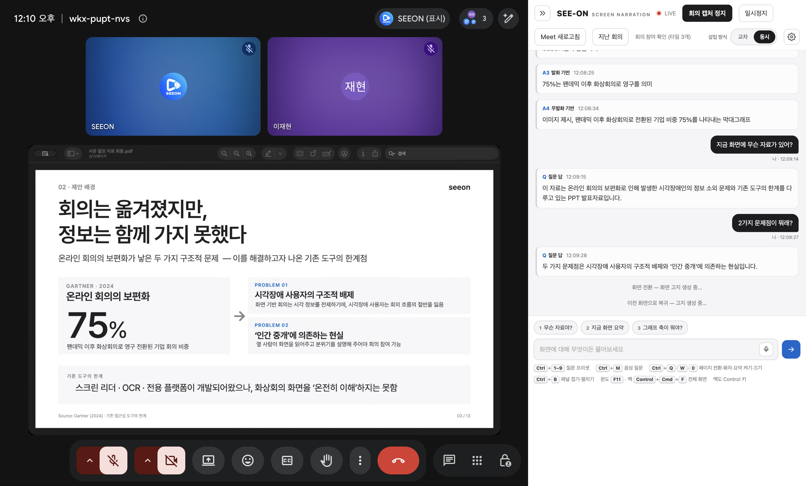

> 왼쪽은 실제 Google Meet 회의(발표 화면 공유 중)이고, 오른쪽은 seeon이 만든 화면 해설이
> 실시간으로 쌓이는 패널이에요.

---

## 목차

- [화면 구성](#화면-구성)
- [준비물](#준비물)
- [설치하기](#설치하기)
- [회의 시작하기](#회의-시작하기)
- [무엇을 언제 말해 주는가](#무엇을-언제-말해-주는가)
- [직접 물어보기](#직접-물어보기)
- [단축키](#단축키)
- [안내 타이밍 — 삽입 방식과 프로필](#안내-타이밍--삽입-방식과-프로필)
- [회의 요약](#회의-요약)
- [설정](#설정)
- [소리가 나가는 방식](#소리가-나가는-방식)
- [안내를 하지 않는 경우](#안내를-하지-않는-경우)
- [개발자용 문서](#개발자용-문서)

---

## 화면 구성

창은 좌우로 나뉘어요. **왼쪽은 Google Meet**, **오른쪽은 SEEON 패널**이에요.
회의는 왼쪽에서 평소처럼 진행하고, 오른쪽 패널이 화면을 대신 읽어줘요.

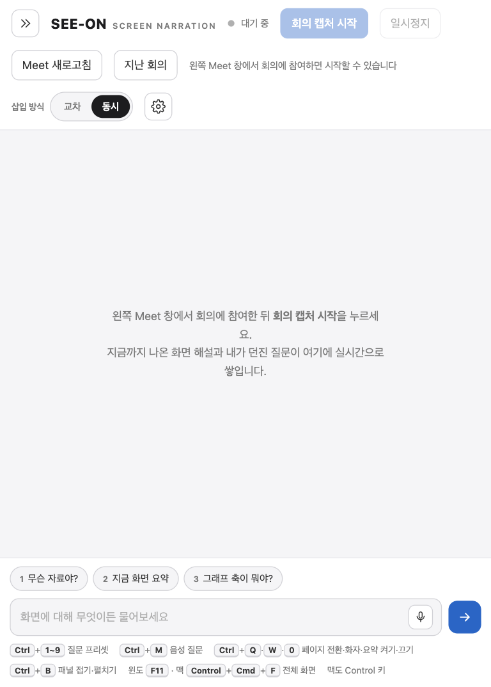

오른쪽 패널은 세 부분으로 이뤄져 있어요.

- **위쪽 머리줄** — 왼쪽부터 이렇게 놓여 있어요.
  - 패널 접기 버튼(`»`) — [패널 접기·펼치기](#패널-접기펼치기)
  - 로고와 라이브 상태(`대기 중` ↔ `LIVE`)
  - `회의 캡처 시작`(캡처 중에는 `회의 캡처 정지`) · `일시정지`(멈춘 동안은 `재개`) 버튼
  - `Meet 새로고침` · `지난 회의` 버튼
  - 회의 참여 안내 — 회의에 들어가 있으면 "회의 참여 확인 (타일 N개)", 아니면 참여하라는 안내가 보여요.
  - 꺼진 기능 배지 — 페이지 전환 안내·화자 안내·회의 요약 중 꺼 둔 것이 있으면 빨간 글씨로 `꺼진 기능: …` 이 떠요.
  - `삽입 방식`(교차·동시)과 `교차 프로필`(품질·균형·성능), 설정(톱니) 아이콘
- **가운데 스트림** — 화면 해설 카드와 내가 던진 질문이 채팅처럼 위에서 아래로 쌓여요.
  캡처 시작, 기능 켜짐·꺼짐 같은 앱 안내도 가운데에 작은 글씨로 함께 쌓여요.
- **아래쪽 입력줄** — 질문 프리셋 버튼, 질문 입력창, 음성 질문(마이크) 버튼과 전송 버튼, 그리고 단축키 안내가 있어요.

해설 카드 머리에는 어떤 안내인지 코드와 이름이 붙어요.

| 코드 | 이름 | 언제 나오나 |
|---|---|---|
| `A1` | 페이지 전환 | 화면이 바뀔 때 |
| `A2` | 지시 대상 | 발표자가 화면의 무언가를 가리킬 때 |
| `A3` | 발화 기반 | 숫자·주장·정도를 화면과 이어 줄 때 |
| `A4` | 무발화 기반 | 말없이 화면만 보여 줄 때 |
| `A5` | 화자 식별 | 말하는 사람이 바뀔 때 |
| `Q` | 질문 답 | 내가 물어본 질문의 답 |

### 패널 접기·펼치기

회의 화면을 넓게 보고 싶으면 머리줄 맨 왼쪽 `»` 버튼이나 `Ctrl+B` 로 패널을 접어요.

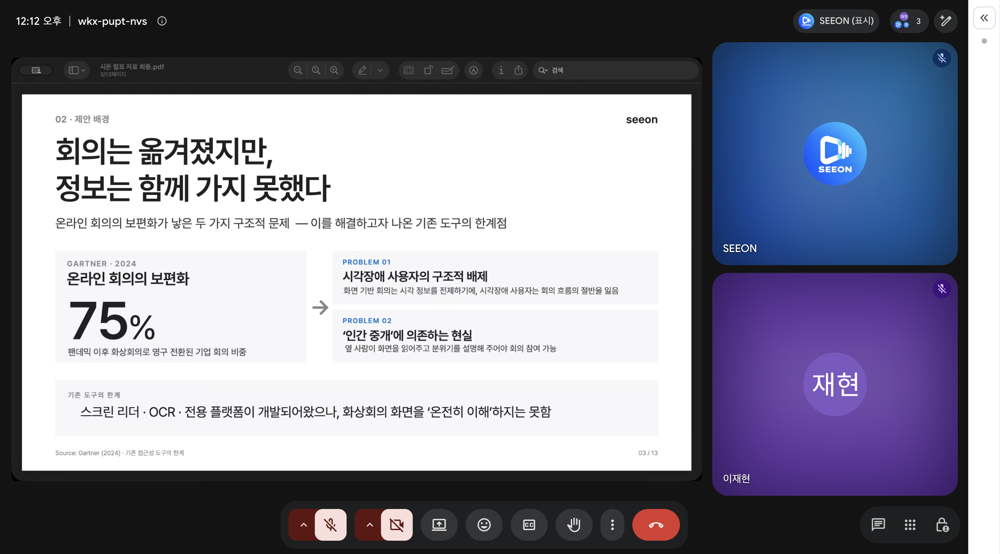

- 접으면 패널이 오른쪽 끝의 좁은 띠로 줄고, 그만큼 Meet 화면이 넓어져요. 창 크기·위치, 최대화·전체 화면 상태는 그대로예요.
- 띠에는 펼치기 버튼(`«`)과 캡처 상태 점(캡처 중이면 빨간색)만 남아요. `«` 나 `Ctrl+B` 를 다시 누르면 펼쳐져요.
- 접혀 있어도 해설 소리와 스크린리더 안내는 그대로 나와요. 접혀 있던 동안 쌓인 카드는 펼치면 맨 아래까지 내려가 보여요.
- 알림 창·지난 회의 창·"회의 소리를 모으는 중" 안내가 뜨면 패널이 저절로 펼쳐져요. 접을 때 열려 있던 설정 패널은 닫혀요.
- 메뉴 `보기 → SEEON 패널 접기·펼치기` 로도 할 수 있어요. 앱을 다시 켜면 펼친 상태로 시작해요.

패널을 접고 전체 화면(Windows `F11`, 맥 `Control+Cmd+F`)으로 띄우면 회의 화면을 가장 크게 볼 수 있어요.

---

## 준비물

- **Google Meet 계정** — 왼쪽 창에서 회의에 참여하는 데 써요.
- **헤드셋** — 스피커로 들으면 안내 음성이 마이크를 타고 회의로 새어 나가니 꼭 써주세요.
- **화면 해설 AI 서버** — 화면을 읽고, 회의 소리를 받아쓰고, 안내를 목소리로 바꿔 주는 AI 서버에 연결해서 동작해요.
  서버를 준비하고 연결하는 방법은 [개발자용 문서](docs/development.md)에 있어요.
- **Windows 또는 macOS** 컴퓨터

---

## 설치하기

**Windows**

1. `SEEON-Setup-<버전>.exe` 를 더블클릭해요. 관리자 권한 없이 내 계정에만 설치돼요.
2. 처음 실행하면 서명하지 않은 앱이라 **"Windows의 PC 보호"**(SmartScreen) 창이 떠요.
   **추가 정보** → **실행** 을 누르면 설치가 이어져요.
3. 설치가 끝나면 앱이 바로 켜지고, 바탕화면과 시작 메뉴에 **SEEON** 바로가기가 생겨요.
   다음부터는 바탕화면 아이콘을 더블클릭하면 돼요.

**macOS** 나 소스에서 직접 실행하는 방법, 설치 파일을 만드는 방법은 [개발자용 문서](docs/development.md)에 있어요.

---

## 회의 시작하기

1. 왼쪽 **Google Meet** 창에서 회의에 참여해요.
2. 발표 자료 안내를 받으려면 발표자가 **화면을 공유**해야 해요.
   (내가 발표한다면 창·문서 단위로 공유해요. 전체 화면 공유는 앱이 거울처럼 반복되니 피하는 게 좋아요.)
3. 오른쪽 패널이 회의 참여를 감지하면(머리줄에 "회의 참여 확인 (타일 N개)") `회의 캡처 시작` 버튼이 켜져요. 이 버튼을 눌러요.

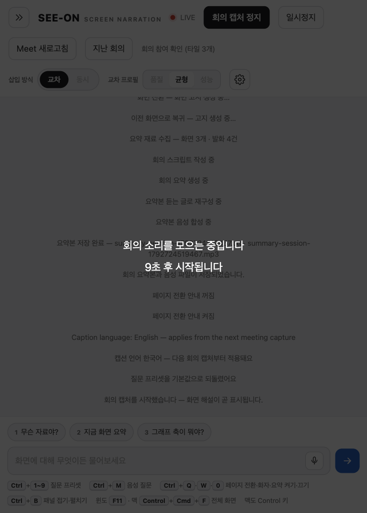

캡처가 시작되면 머리줄이 **`LIVE`** 로 바뀌고, 잠시 뒤부터 화면이 바뀔 때마다
해설 카드가 스트림에 쌓여요.

- 꺼 둔 기능이 있거나 캡션 언어가 한국어가 아니면 시작할 때 스트림과 스크린리더로 한 번 알려 줘요.
  이 설정들은 앱을 다시 켜도 남아 있어서, 모르는 채로 회의를 듣지 않게 하려는 거예요. ([설정](#설정))
- 잠깐 멈추고 싶으면 `일시정지`를 눌러요. 받아쓰기·해설·가리킴 찾기·화자 확인이 멈추고, `재개`를 누르면 이어서 해요.
- 끝내려면 `회의 캡처 정지`를 눌러요. 회의를 나가도 캡처는 저절로 멈추지 않으니 꼭 눌러 주세요.
  멈추면 회의 스크립트를 남기고, 요약 기능이 켜져 있으면 요약본을 만들어요. ([회의 요약](#회의-요약))

왼쪽 Meet 화면이 검게 남거나 회의가 아닌 페이지로 넘어갔다면 `Meet 새로고침`(`Ctrl/Cmd+R`, 메뉴 `보기 → Meet 화면 새로고침`)을 눌러요.
회의 중이면 그 회의를 다시 불러오고(회의에 다시 참여해야 해요), 회의 밖이면 Meet 첫 화면으로 돌아와요.
왼쪽 화면에서 새 창으로 열리는 링크(도움말 등)는 Meet·구글 로그인이 아니면 기본 브라우저에서 열려요.

---

## 무엇을 언제 말해 주는가

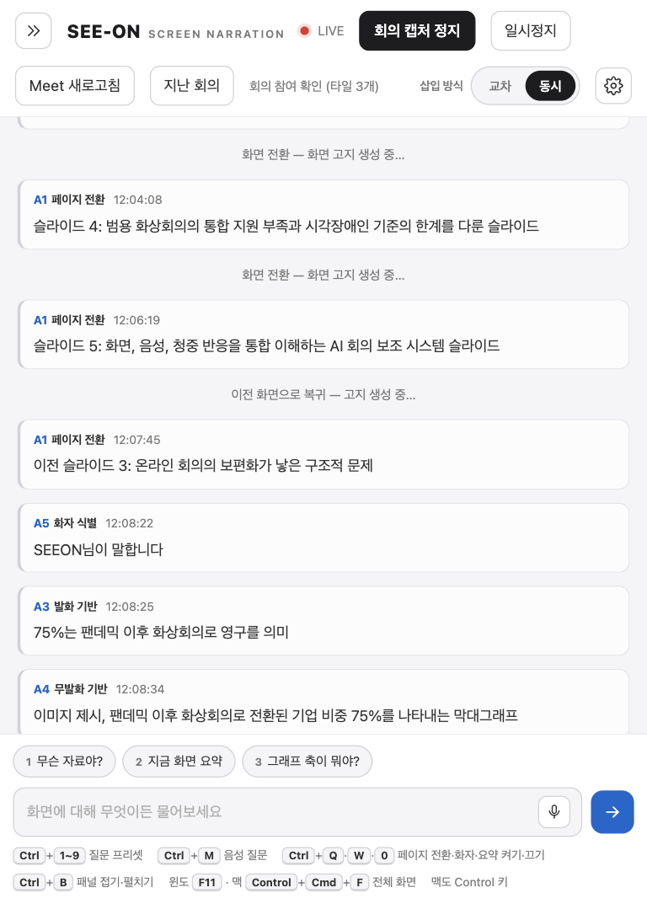

### 말할지 말지를 가려내는 방식

발화 속 정보 공백은 두 단계로 가려내요.

1. **화면을 봐야 알 수 있는 말 찾기** — 받아쓴 발화에서 화면을 봐야 뜻을 알 수 있는 표현을 찾아요.

   | 유형 | 예 |
   |---|---|
   | 가리키는 말 | 이 부분, 여기, 이렇게, this part, there |
   | 꾸밈말 + 가리키는 말 | 빨간 쪽, 싼 거, the cheaper one |
   | 숫자 | 30%, 12.5톤, 64 people |
   | 변화·비교·결론 | 많이 올랐습니다, 결국 더 낮게 나왔습니다, more reliable than |
   | 정도를 나타내는 말 | 꽤 넓죠, really big |
   | 말 없음 | 발표자가 화면만 띄워 두고 한동안 말이 없음 |

2. **말로 이미 채워졌는지 확인하기** — 앞뒤 발화만 듣고도 무엇을 가리키는지, 값과 정도가 얼마인지 알 수 있으면 말하지 않아요.
   앞뒤에서 언급된 것과 이어지면 이름을 말하지 않았어도 공백이 아니에요("워크숍 장소는 … 거기가" → 말하지 않음).
   애매하면 말하지 않아요. 화면 전환·화자 안내는 이 확인 없이 바로 알려요.

### 화면이 바뀔 때

발표 자료가 넘어가면 그 화면이 무엇인지 한 문장으로 알려줘요.
PPT 는 "슬라이드 N:" 으로, 웹페이지·문서·바탕화면 같은 다른 화면은 번호 없이 "페이지:" 로 알려요.
슬라이드 번호는 PPT 만 세요.

> 슬라이드 1: 시각장애인을 위한 실시간 화상회의 접근성 멀티에이전트 프로젝트 소개 슬라이드
>
> 페이지: 구청 민원 접수 방법을 안내하는 웹페이지

- **스쳐 지나간 화면은 말하지 않아요.** 3초 이상 머문 화면만 안내해요.
  (위 스트림에서 슬라이드 2·4가 카드 없이 지나간 게 그 예예요.)
- **이미 봤던 화면으로 되돌아가면 짧게 말해요** — "이전 슬라이드 3: 세션 하이재킹 개념", "이전 페이지: 여행 후기 블로그".
- 바탕화면·파일 탐색기·설정 창도 "페이지:" 로 알려요. 무슨 화면인지 확실하지 않을 때만 조용히 있어요.
- 문장이 자연스럽게 맺히지 않으면 **말하지 않아요.** 어색한 안내는 없느니만 못하니까요.

### 발표자가 화면의 무언가를 가리킬 때

"이거 보시면", "여기 이 부분이" 같은 발화가 나오면, 그 순간 화면에서 무엇을 가리키는지 찾아서
발화와 이어 붙여 말해줘요.

> 2년간 매출 추이 표

가리키는 대상을 화면에서 찾지 못하면 **추측하지 않고 조용히 있어요.**

### 숫자와 주장을 이어야 할 때

발화에는 수치만 나오고 그 의미가 화면에 있을 때(또는 그 반대일 때) 둘을 이어줘요.

> 73%는 작년 대비 기업가치 성장률을 의미

### 크기·넓이를 말로만 할 때

발표자가 화면에 보이는 대상의 정도를 "꽤 넓죠", "정말 크죠"처럼 말로만 하면, 화면에서 그 정도를 찾아 알려줘요.
시간·부담처럼 화면으로 볼 수 없는 성질("대기 시간이 꽤 길죠")은 말하지 않아요.

> 피해 지역은 지도에서 시 면적의 절반 정도

### 사진이 단독으로 제시될 때

발표자가 설명 없이 사진만 띄우면, 사진에 무엇이 있는지 알려줘요. 크기를 가늠하기 어려운
대상은 화면 속 다른 물체와 비교해서 말해줘요.

> 소나무보다 4배 큰 불상

### 말하는 사람이 바뀔 때

발화자가 바뀌면 누구인지 알려줘요. 같은 사람이 계속 말하는 동안에는 반복하지 않아요.

> 홍길동님이 말합니다

- 회의 앱이 표시하는 발화자 정보를 먼저 쓰고, 그것으로 알 수 없으면 화면을 읽어서 판단해요.
- 카메라를 끈 참가자도 화면의 강조 표시로 찾아내요.
- 여러 명이 동시에 말하거나 본인이 말할 때는 안내하지 않아요.

---

## 직접 물어보기

궁금할 때 아래 입력줄로 물어볼 수 있어요. **그 순간의 화면을 보고** 답해줘요.

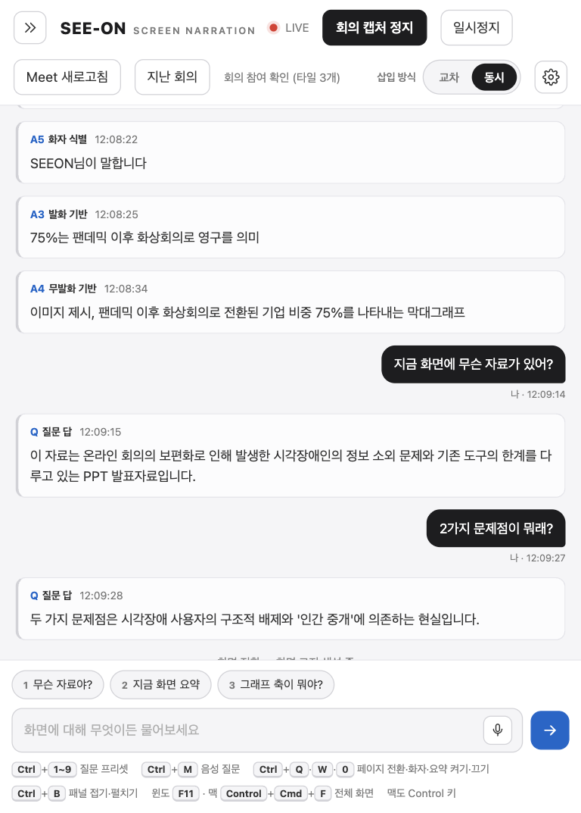

물어보는 방법은 세 가지예요.

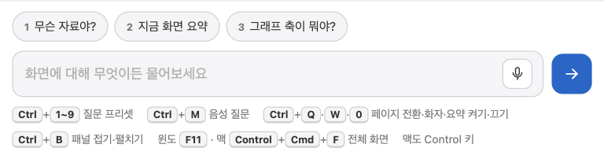

- **자유롭게 타이핑** — 입력창에 무엇이든 적어 보내요. ("지금 화면에 무슨 자료가 있어?")
- **질문 프리셋** — 입력창 위 버튼이나 `Ctrl+1~9`로 바로 물어봐요. 처음에는 세 개가 들어 있어요.
- **음성 질문** — 마이크 버튼이나 `Ctrl+M`을 누르고 말해요. 내 마이크 소리만 듣고, 다시 누르거나 말을 멈추면 끝나요.
  녹음하는 동안은 Meet 마이크를 잠시 꺼서 질문이 회의 참가자에게 들리지 않게 하고, 끝나면 다시 켜요.
  (원래 꺼 두었던 마이크는 켜지 않아요.)

질문은 회의 캡처 중에만 할 수 있어요. 캡처 전에 물으면 캡처를 먼저 시작하라고 알려 줘요.

질문한 답은 다른 안내보다 먼저 들려줘요. 다른 안내가 나오고 있으면 그 안내를 끝까지 들려준 뒤 바로 답해요.
답을 기다리는 동안에는 다른 안내를 잠시 멈추고, 그사이 이미 지나가 버린 내용의 안내는 들려주지 않아요.

| 단축키 | 기본 프리셋 | 묻는 것 |
|---|---|---|
| `Ctrl+1` | 무슨 자료야? | 지금 어떤 자료가 공유되고 있나 (자료의 형태와 주제) |
| `Ctrl+2` | 지금 화면 요약 | 이 화면에 있는 자료를 빠짐없이 정리해 달라 |
| `Ctrl+3` | 그래프 축이 뭐야? | 그래프의 가로축·세로축이 무엇이고 단위와 범위는 어떻게 되나 |

화면에 그래프가 없는데 `Ctrl+3`을 누르면 지어내지 않고 없다고 답해줘요.
프리셋은 설정의 `질문 프리셋`에서 고치거나 지우고, 9개까지 넣을 수 있어요([질문 프리셋 바꾸기](#질문-프리셋-바꾸기)). 고치거나 새로 넣은 질문은 입력창에 적은 질문처럼 답해요.
비어 있는 번호를 누르면 그 번호에 넣은 질문이 없다고 알려 줘요.

---

## 단축키

| 단축키 | 하는 일 |
|---|---|
| `Ctrl+1` ~ `Ctrl+9` | 질문 프리셋 1~9번 묻기 |
| `Ctrl+M` | 음성 질문 녹음 켜기·끄기 |
| `Ctrl+Q` | 페이지 전환 안내 켜기·끄기 |
| `Ctrl+W` | 화자 안내 켜기·끄기 (회의 캡처를 시작하기 전에만) |
| `Ctrl+0` | 회의 요약 켜기·끄기 |
| `Ctrl+B` | SEEON 패널 접기·펼치기 |
| `Ctrl+R` (맥 `Cmd+R`) | Meet 화면 새로고침 |
| `F11` (맥 `Control+Cmd+F`) | 전체 화면 |
| `Esc` | 설정 패널·지난 회의 창 닫기 |

- 맥에서도 글자 키(`M`·`Q`·`W`·`B`)는 **Control** 로 눌러요. `Cmd+M`(최소화)·`Cmd+Q`(종료)·`Cmd+W`(닫기)는 원래 기능 그대로예요.
  숫자 키(`1~9`·`0`)는 Control·Cmd 둘 다 돼요.
- 왼쪽 Meet 화면을 보고 있어도, 오른쪽 패널에 있어도 똑같이 동작해요. 한글 입력 상태에서도 돼요.
- 키를 누르고 있어도 같은 질문이 여러 번 나가지 않아요.
- Windows 에서는 `Ctrl+M`·`Ctrl+W` 가 최소화·닫기와 겹치지 않도록 창 메뉴를 뺐어요. 최소화·닫기는 제목 표시줄 단추나 `Alt+F4` 로 해요.
- 기능을 단축키로 켜고 끄면 바뀐 상태를 스트림에 띄우고 스크린리더로도 읽어 줘요.

---

## 안내 타이밍 — 삽입 방식과 프로필

안내를 **언제** 끼워 넣을지 머리줄의 `삽입 방식`에서 고를 수 있어요. 처음에는 **동시**로 시작해요.

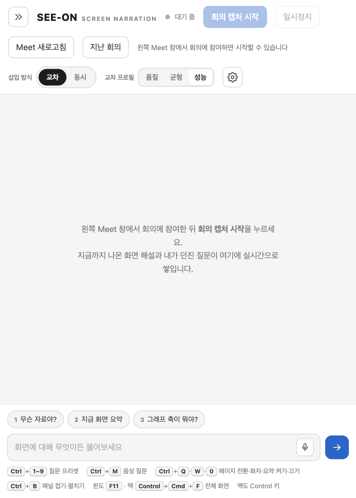

- **동시** — 회의 소리와 안내가 겹쳐서 바로 들려요. 실시간성이 가장 높아요.
- **교차** — 발화가 잠시 쉬는 틈을 노려 안내를 끼워 넣어서 조금 늦게 들려요.
  겹침이 적어서 알아듣기 편해요. 교차를 고르면 세 가지 **프로필**이 나타나요.

| 프로필 | 성격 | 회의를 늦춰 듣는 시간 |
|---|---|---|
| **품질** | 가장 정교하게 다듬어서 넣어요 (조금 더 느려요) | 약 60초 |
| **균형** | 품질과 속도의 절충이에요 | 약 10초 |
| **성능** | 가장 빠르게 넣어요. 안내하는 동안 멈춘 회의를 조금 빨리 들려주며 따라잡아요 | 없음 |

- `품질`·`균형`은 회의를 그만큼 늦춰 들려줘요. 늦출 만큼 회의 소리를 모으는 동안(캡처를 시작할 때나 캡처 중에 바꿨을 때)
  "회의 소리를 모으는 중입니다 · N초 후 시작됩니다" 화면이 떠요. 늦춰 들려주는 중에 문제가 생기면 저절로 `동시`로 바꿔요.

> 회의 캡처 중에 `품질`·`균형`으로 바꾸면 그 캡처가 끝날 때까지 다른 방식으로 되돌릴 수 없어요(놓친 구간 없이 들려주려는 거예요).
> 캡처를 시작하기 전에는 자유롭게 고를 수 있어요.

---

## 회의 요약

회의 중 오간 발화와 화면 안내를 모아서 **요약본(글 + 음성)** 을 만들어요.
`Ctrl+0` 으로 요약 기능을 켜고 끌 수 있어요.

회의 캡처를 정지하면 먼저 **회의 스크립트**가 만들어져요. 회의 하나가 글 파일 하나로 정리되는데,
발화마다 누가 말했는지(Meet 화면의 말하는 사람 표시 기준, 알 수 없으면 `화자 미상`)를 적고,
(설정에서 화자 안내를 끄면 화자를 판별하지 않아서, 꺼 둔 동안의 발화는 화자 없이 적어요)
화면이 바뀔 때마다 그 화면을 설명한 안내(페이지 전환 안내) 한 줄을 끼워 넣어요.
3초를 못 채우고 지나간 화면은 넣지 않아요.

```
[02:30] ── 슬라이드 3: 분기별 매출 막대그래프 ──
[02:31] 홍길동: 보시는 것처럼 3분기가 제일 높습니다
[02:36] 화자 미상: 4분기는 어떻게 예상하세요?
```

요약 기능이 켜진 채로 회의 캡처를 정지하면, 스크립트를 바탕으로 요약을 쓰고
귀로 듣기 좋게 다듬어 글과 음성으로 저장해요. 요약에는 누가 말했는지는 쓰지 않아요.
요약 기능을 꺼 두면 요약본은 만들지 않고 회의 스크립트만 남겨요.

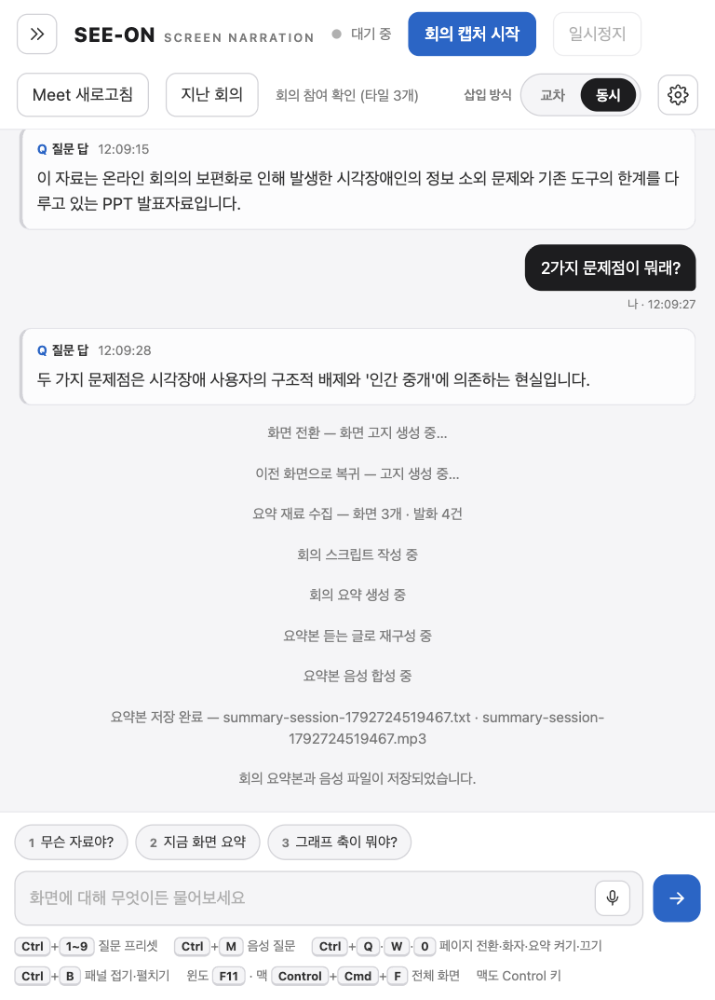

만들어진 요약본은 이런 모습이에요.

> **회의 요약**
> 회의 길이: 5분 · 슬라이드 4장 · 발화 0건
>
> **개요** — 이 회의는 시각장애인을 위한 실시간 화상회의 접근성 멀티에이전트 서비스인
> '화면을 듣는 회의'를 소개하는 자리였습니다. …
>
> **슬라이드별 내용** — 첫 장은 표지였습니다. 서비스 이름과 팀 이름이 함께 놓여 있었고,
> 발표자가 영문명 자리에 커서를 두어 정식 명칭을 짚었습니다. …

### 지난 회의

회의 스크립트와 요약본은 회의마다 **문서 폴더의 `SEEON 회의 기록`** 에 날짜별로 남아요.

```
문서/SEEON 회의 기록/
└── 2026-10-23 14-05 회의/
    ├── 대화 스크립트.txt
    ├── 회의 요약.txt
    └── 회의 요약.mp3
```

머리줄의 `지난 회의`를 누르면 앱 안에서 바로 읽을 수 있어요.

- 목록은 최신 회의부터 "10월 23일 오후 2시 5분 회의, 분기 실적 보고 · 매출 추이, 25분, 요약 있음"처럼 한 줄씩 보여요.
  회의 제목은 앞쪽 슬라이드 제목 두 개로 붙여요.
- 회의를 고르면 회의 요약과 대화 스크립트를 함께 보여 줘요. `목록으로`를 누르면 목록으로 돌아가요.
- `폴더 열기`는 목록에서는 기록 폴더 전체를, 회의 하나를 연 상태에서는 그 회의 폴더를 열어요.

---

## 설정

머리줄의 톱니 아이콘을 누르면 설정 패널이 열려요. `Esc`를 누르거나 패널 바깥을 누르면 닫혀요.

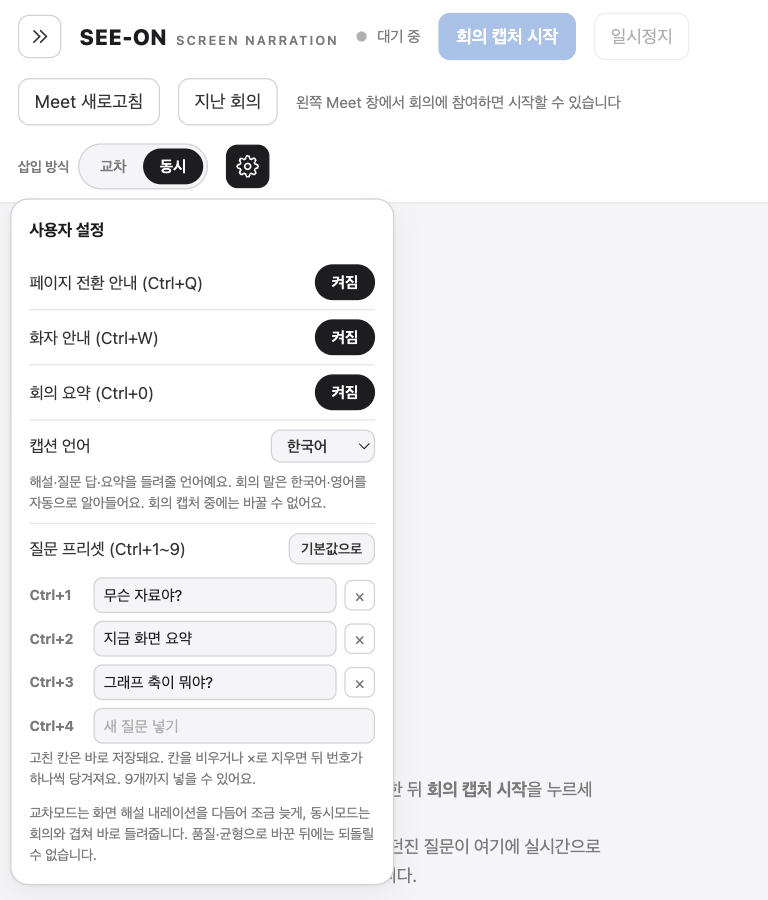

| 항목 | 하는 일 |
|---|---|
| 페이지 전환 안내 (`Ctrl+Q`) | 화면이 바뀔 때 안내(`A1`)를 켜고 꺼요 |
| 화자 안내 (`Ctrl+W`) | 말하는 사람이 바뀔 때 안내(`A5`)를 켜고 꺼요. 끄면 화자 판별 자체를 하지 않아서 **회의 캡처를 시작하기 전에만** 바꿀 수 있어요 |
| 회의 요약 (`Ctrl+0`) | 캡처를 마칠 때 요약본을 만들지 정해요 |
| 캡션 언어 | 해설·질문 답·요약을 들려줄 언어(한국어·English)예요. 앱 화면 글자도 이 언어로 바뀌어요 |
| 질문 프리셋 (`Ctrl+1~9`) | 프리셋 문구를 고치고, 넣고, 지워요 |

기능 켜기·끄기, 캡션 언어, 질문 프리셋은 **앱을 다시 켜도 남아 있어요.**

### 기능 켜기·끄기와 단축키

페이지 전환 안내·화자 안내·회의 요약은 설정의 스위치나 단축키로 켜고 꺼요.

| 기능 | 단축키 | 꺼 두면 |
|---|---|---|
| 페이지 전환 안내 | `Ctrl+Q` | 화면이 바뀌어도 "슬라이드 N: …" 안내와 "화면 전환 — 화면 고지 생성 중…" 진행 안내를 띄우지 않아요 |
| 화자 안내 | `Ctrl+W` | 말하는 사람이 바뀌어도 알리지 않고, 화자 판별 자체를 하지 않아요 (회의 캡처를 시작하기 전에만 바꿀 수 있어요) |
| 회의 요약 | `Ctrl+0` | 캡처를 마쳐도 요약본을 만들지 않고 회의 스크립트만 남겨요 |

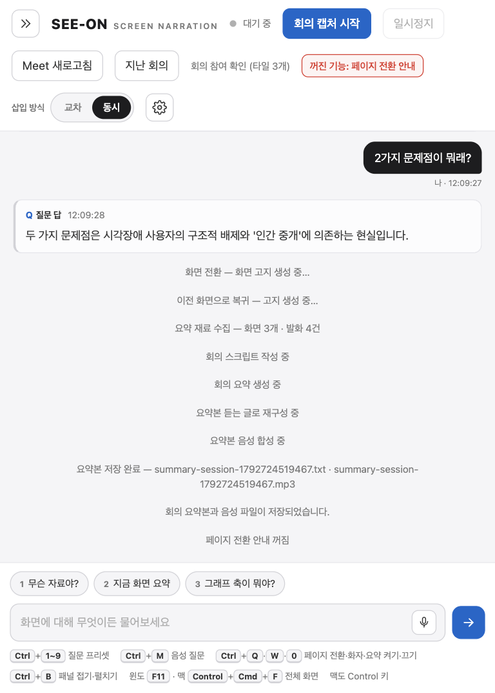

- 꺼 둔 기능은 머리줄에 빨간 **`꺼진 기능: …`** 배지로 계속 보여요. 앱을 다시 켜도 꺼진 채로 남아서, 캡처를 시작할 때도 한 번 알려 줘요.
- 단축키로 바꾸면 "페이지 전환 안내 꺼짐"처럼 바뀐 상태를 스트림에 띄우고 스크린리더로도 읽어 줘요.
- 페이지 전환·화자 안내를 꺼도 화면과 발화는 계속 모아요. 안내만 내보내지 않아요.
- 화면 해설(지시·발화 기반·무발화)과 질문은 이 스위치로 끄는 기능이 아니라 늘 동작해요.

### 캡션 언어

해설·질문 답·회의 요약을 **한국어**로 들을지 **English**로 들을지 골라요.
안내 목소리뿐 아니라 버튼·설정·알림 같은 **앱 화면 글자도 이 언어로 바뀌어요.**

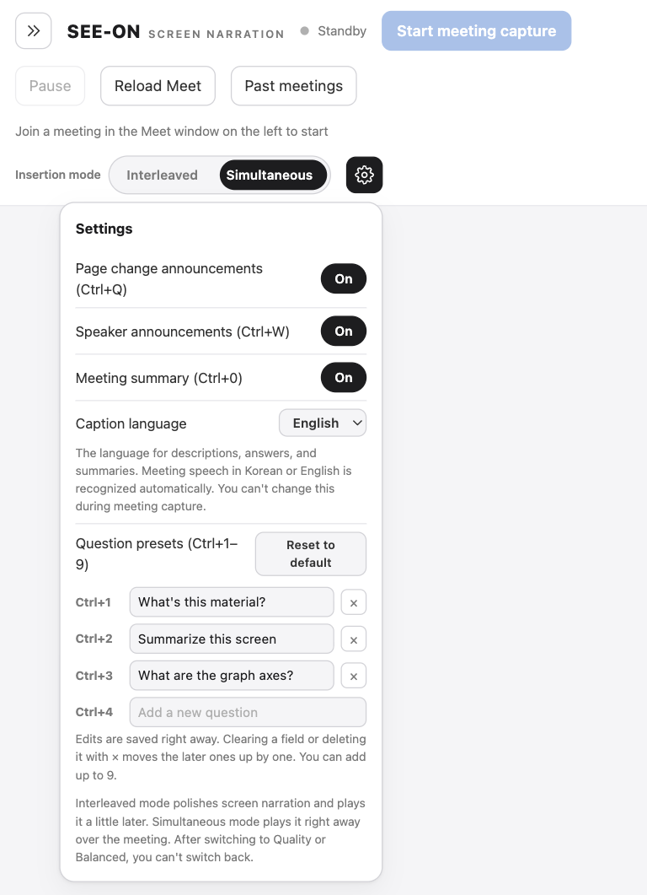

- 회의에서 오가는 말은 따로 고르지 않아도 한국어·영어를 자동으로 알아들어요.
- 캡션 언어는 **회의 캡처 중에는 바꿀 수 없고**, 바꾸면 다음 캡처부터 적용돼요.
- 한국어가 아닌 언어를 골라 두면 캡처를 시작할 때 지금 캡션 언어를 알려 줘요.

### 질문 프리셋 바꾸기

자주 묻는 질문을 버튼으로 만들어 두고 `Ctrl+1` ~ `Ctrl+9`로 바로 물어볼 수 있어요.
처음 세 개(무슨 자료야? · 지금 화면 요약 · 그래프 축이 뭐야?) 말고도 내 질문을 넣을 수 있어요.

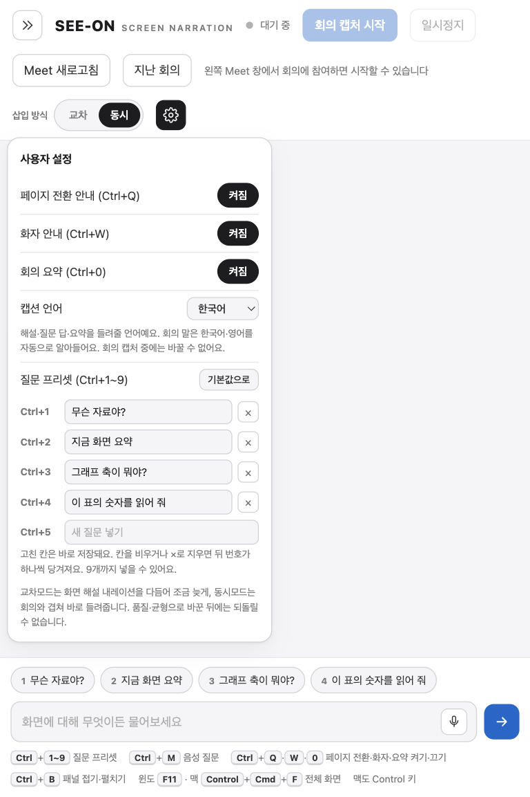

- 맨 아래 `새 질문 넣기` 칸에 적고 Enter 를 누르면 다음 번호(`Ctrl+4`…)로 들어가고, 입력줄에 버튼이 바로 생겨요(9개까지).
- 칸을 고치면 바로 저장돼요. 칸을 비우거나 `×`로 지우면 뒤 번호가 하나씩 당겨져요.
- `기본값으로`를 누르면 처음 세 개로 돌아가요.
- 처음 세 개는 화면에 맞춘 전용 질문으로 답하고, 고치거나 새로 넣은 질문은 입력창에 적은 질문처럼 답해요.

---

## 소리가 나가는 방식

**동시** 모드에서는 안내 음성과 회의 소리가 함께 들려요. 서로 방해하지 않도록 공간을 나눠요.

- 안내 음성은 **오른쪽**(SEEON 패널 쪽), 회의 소리는 **왼쪽**(회의 화면 쪽)에서 들려요.
- 안내가 나가는 동안 회의 소리는 잠시 작아졌다가 원래대로 돌아와요.
- 회의는 멈추지 않아요. 실시간성을 잃지 않으려는 선택이에요.

**교차** 모드에서는 안내하는 동안 회의 소리를 잠시 멈추고, 안내가 끝나면 조금 빨리 돌려 따라잡아요.
질문의 답만은 회의를 멈추지 않고, 동시 모드처럼 회의 소리를 줄인 채 오른쪽에서 들려줘요.

---

## 안내를 하지 않는 경우

말할 수 있는데 안 하는 게 아니라, **말하면 안 되는 상황을 가려내요.**

- 화면을 보지 않아도 발화만으로 알 수 있는 내용
- 방금 안내한 것과 사실상 같은 내용
- 화면에서 근거를 찾지 못한 추측
- 3초를 못 채우고 지나간 화면
- 문장이 어중간하게 끊긴 안내
- 비슷한 종류의 해설이 방금 나간 직후의 해설 ([아래](#안내가-몰릴-때))
- 설정에서 꺼 둔 안내(페이지 전환 안내·화자 안내) ([설정](#설정))

### 안내가 몰릴 때

안내가 한꺼번에 여러 개 생기면 **더 중요한 안내부터** 들려줘요.

1. 직접 물어본 질문의 답
2. 화면이 바뀔 때 안내 · 말하는 사람이 바뀔 때 안내
3. 화면 내용을 설명하는 해설 — 말없이 화면을 보여 줄 때, 숫자·주장을 이어 줄 때, 화면을 가리킬 때

- 화면 내용을 설명하는 해설이 방금 나갔으면, 비슷하거나 덜 중요한 해설은 잠시 쉬어서 안내가 몰리지 않게 해요.
- 질문의 답·화면 전환 안내·화자 안내는 해설을 막지 않아요. 슬라이드를 넘기자마자 "이거 보시면" 하고 가리켜도 해설이 나가요.
- 너무 오래 차례를 기다린 해설은 이미 지나간 내용이라 들려주지 않아요. 재생 중인 안내를 끊는 건 질문의 답뿐이에요.

---

## 개발자용 문서

앱을 소스에서 실행하는 방법, AI 서버 연결과 환경 변수, 설치 파일 만들기, 안내를 고르는 세부 규칙,
개발자 모드는 [docs/development.md](docs/development.md) 에 정리해 두었어요.
